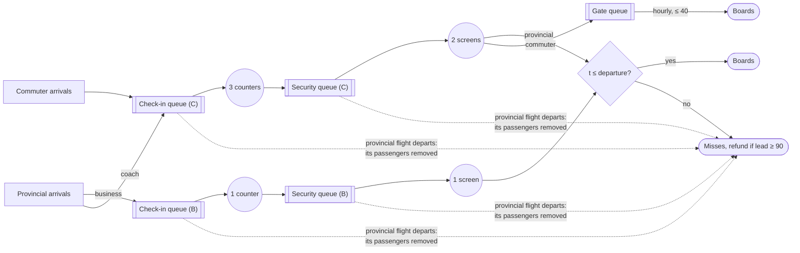

# Conceptual Model — SFMA Passenger Processing

Phase I deliverable. Keep this in sync with the code.

## 1. Objective & Scope

Find a check-in staffing/allocation policy (max 6 counters) that balances passenger service against
cost, keeping staffing cost ≤ 5% of ticket revenue.

- **In scope:** arrival → check-in → security → gate → departure (or leaving after a missed flight).
- **Out of scope:** walking time, baggage handling after check-in, flight delays, rebooking, security wages.
- **Horizon:** 7 days (10,080 min), starting empty at 00:00 Day 1. All times are in minutes.

## 2. Entities

**Passenger**

| Attribute | Values / notes |
|---|---|
| `type` | commuter / provincial |
| `class` | business / coach (commuters are always coach) |
| `arrival_time` | Time they join the check-in queue |
| `n_bags` | 0, 1, 2 |
| `flight`, `departure_time` | Provincial: set at booking. Commuter: set when they board |
| `lead_time` | Provincial only: minutes before departure |
| `refund_eligible` | Provincial only: `lead_time ≥ 90` |
| `t_checkin_start/end`, `t_security_start/end`, `t_board` | Timestamps used for waiting times |
| `times_left_behind` | Commuter only |
| `outcome` | boarded / missed / still in system at end |

**Flight**

| Attribute | Commuter | Provincial |
|---|---|---|
| `departure_time` | Every hour at :30 (168 flights) | Every 6 h, 06:00 Day 1 to 00:00 Day 8 (28 flights) |
| `capacity` | 40 coach | 40 business + 140 coach |
| `booked` | — | Binomial(40, 0.75) business, Binomial(140, 0.85) coach |
| `boarded`, `missed` | Boarded count | Counts |

## 3. Resources & Queues (baseline)

| Station | Business | Coach (provincial coach + commuters) | Queue |
|---|---|---|---|
| Check-in | 1 counter | 3 counters | Separate FIFO queues |
| Security | 1 screen | 2 screens | Separate FIFO queues |
| Commuter gate | — | 40 seats per departure | FIFO by security-completion time |

- Business and coach servers are dedicated to their own class; neither serves the other's queue.
- Queues are unlimited, with no balking or reneging.
- All passengers go through check-in.

## 4. Input Models

| Input | Model |
|---|---|
| Commuter arrivals | Poisson process, 40/h (exponential gaps, mean 1.5 min) |
| Provincial arrivals | Departure − lead time; lead time ~ truncated normal, μ = 75, σ² = 50, truncated to [a, b] min, generated by <method> (UPDATE a, b AND METHOD, THEN REMOVE THIS NOTE) |
| Checked bags | Commuter P(0, 1, 2) = (0.70, 0.25, 0.05); provincial (0.30, 0.50, 0.20) |
| Check-in time | Exp(2) + (sum of B × Exp(1)) + Exp(3), components independent |
| Security time | Exp(3) |

Each source of randomness uses its own seeded random stream.

## 5. Events

| Event | Logic |
|---|---|
| **Init** | Build flights; create provincial passengers and schedule their arrivals; schedule the first commuter arrival, all departures, and End. |
| **Arrival** | Start check-in if a counter in the pool is free, otherwise join the queue. Commuter arrivals also schedule the next commuter arrival. |
| **Check-in done** | Provincial passenger whose flight has left: missed, leaves. Otherwise move to security (start or queue). Then pull the next passenger from the check-in queue. |
| **Security done** | Provincial: board if `t ≤ departure`, otherwise missed. Commuter: join the gate queue. Then pull the next passenger from the security queue. |
| **Commuter departure** | Board up to 40 from the front of the gate queue; everyone left is "left behind". |
| **Provincial departure** | Close the flight. Remove that flight's passengers from every check-in and security queue and mark them missed. Passengers already in service finish service, then leave as missed. |

Every missed provincial passenger is refunded if `refund_eligible`.
| **End** | Stop; record whoever is still in the system. |

**Tie-break rule:** events at the same time run in this order: security done → check-in done →
departures → arrivals → End, then in the order they were scheduled. Security finishing exactly at
departure therefore catches the flight.

## 6. State Variables

Clock; future event list; busy servers and queue contents per pool; gate queue; per-flight
boarded/missed counts; accumulators for queue length, utilization, waits, and money.

**Check:** created = in system + boarded + missed, at every event.

## 7. Decision Variables & Measures

**Decision variables**

| Variable | Baseline | Range |
|---|---|---|
| Business check-in counters | 1 | ≥ 1, business + coach ≤ 6 |
| Coach check-in counters | 3 | ≥ 1, business + coach ≤ 6 |
| Business security screens | 1 | Fixed unless chosen as decision area |
| Coach security screens | 2 | Fixed unless chosen as decision area |

**Measures collected**

| Category | Measure | Definition |
|---|---|---|
| Check-in | Mean wait | `t_checkin_start − arrival_time`, per pool |
| Check-in | Mean / max queue length | Time-average and maximum of queue length, per pool |
| Security | Mean wait | `t_security_start − t_checkin_end`, per pool |
| Security | Mean / max queue length | Time-average and maximum of queue length, per pool |
| Resources | Utilization | Time-average of busy servers ÷ servers, per pool |
| Provincial | % catching / missing | Over all booked provincial passengers |
| Provincial | Refunds | Count and $ value |
| Commuter | Gate wait | `t_board − t_security_end` |
| Commuter | Left behind | Commuters with `times_left_behind ≥ 1` |
| Financial | Revenue, costs, refunds, profit | See money table below |

**Principal KPIs** (get 95% CIs)

| # | KPI | Covers |
|---|---|---|
| 1 | Coach check-in mean wait | Waiting time |
| 2 | % of provincial passengers missing their flight | Service outcome |
| 3 | Coach security utilization | Resource utilization |
| 4 | 7-day profit | Financial |

**Money** (over the 7-day horizon)

| Item | Formula |
|---|---|
| Revenue | Booked provincial business × $1,000 + booked provincial coach × $500 + boarded commuters × $200 |
| Refunds | Ticket price of each missed, refund-eligible provincial passenger |
| Flight cost | 28 × $12,000 + 168 × $1,500 = $588,000 |
| Staffing cost | Check-in counters × $35 × 168 h |
| Profit | Revenue − refunds − flight cost − staffing cost |
| 5% constraint | Staffing cost ≤ 0.05 × (revenue − refunds), checked per replication |

## 8. Assumptions

1. Passengers travel alone and are independent of each other; demand is the same for every flight.
2. Service times are independent of each other and of queue state; servers never take breaks.
3. Travel from security to the gate and boarding both take zero time.
4. Passengers who miss a provincial flight leave at departure time (or once their current service
   ends) and are not rebooked. Commuters left behind wait for a later flight.
5. No real airport data exists, so the model is checked for credibility only, not validated against reality.
